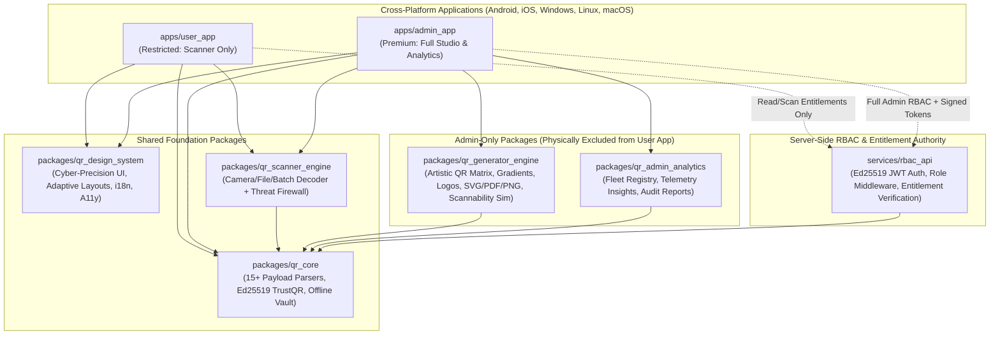

# System Architecture & Security Blueprint
## Universal QR Code Scanner & Generator Platform

---

## 1. Architectural Overview

The ecosystem is structured as a **modular Dart/Flutter poly-package monorepo** with strict compile-time dependency isolation and a dedicated server-side **Cryptographic RBAC & Entitlement Service (`services/rbac_api`)**.



---

## 2. Defense-in-Depth Access Control (Why Users Can Never Unlock Admin Features)

Requirement 2 mandates:
> *"Enforce strict server-side and application-level RBAC/entitlement controls. Regular users must never gain access to admin or premium functionality by modifying the application, APIs, or local data."*

Our architecture enforces a **Three-Layer Zero-Trust Barrier**:

1. **Layer 1 — Physical Compile-Time Binary Separation**:
   - `apps/user_app` and `apps/admin_app` are separate application targets.
   - `apps/user_app/pubspec.yaml` does not depend on `packages/qr_generator_engine` or `packages/qr_admin_analytics`.
   - When Flutter compiles `user_app` to native ARM64/x64 machine code (`.apk`, `.ipa`, `.exe`, Linux ELF, macOS `.app`), the QR generation, artistic customization, batch creation, and admin analytics machine instructions **do not exist in the binary**. No memory patch, flag flip, or local SQLite modification in `user_app` can invoke code that is physically absent.
2. **Layer 2 — Asymmetric Ed25519 Cryptographic Entitlement Tokens**:
   - Entitlement manifests (` EntitlementToken `) are signed using the server's **Ed25519 private key**.
   - Local storage only holds the signed token and the server's **Ed25519 public key**.
   - If a user edits local JSON/SQLite storage to change `"role": "user"` to `"role": "admin"`, the Ed25519 signature verification over the canonical payload fails immediately, invalidating the session.
3. **Layer 3 — Server-Side RBAC Middleware (`services/rbac_api`)**:
   - All privileged REST endpoints (`/api/v1/qr/generate`, `/api/v1/qr/batch`, `/api/v1/qr/sign`, `/api/v1/admin/templates`, `/api/v1/admin/analytics`, `/api/v1/admin/audit`) pass through `requireRole(UserRole.admin)` and `requireScope(...)` middleware on the server.
   - Any request presenting a `role: user` token, an expired token, a revoked token ID (`jti`), or a tampered signature is rejected with `HTTP 403 Forbidden` and logged to the security audit trail.

---

## 3. Innovative & Differentiated Technical Capabilities

1. **TrustQR Cryptographic Authentication Protocol**:
   - Standard QR codes can be easily covered by malicious stickers in public spaces.
   - Our platform supports `TrustQR` envelopes (`trustqr://v1?...&sig=<ed25519_base64url>`), allowing administrators to cryptographically sign QR codes and allowing any `user_app` or `admin_app` scanner to verify authenticity offline against registered public keys.
2. **Zero-Trust Anti-Phishing & Threat Firewall**:
   - Multi-heuristic inspection engine evaluating URI schemes, IDN homograph script mixing (Cyrillic/Greek/Latin), IP obfuscation, TLD risk, Shannon entropy, Wi-Fi authentication downgrade traps, and vCard/SMS payload injection before any OS intent is invoked.
3. **Real-Time Scannability & Michelson Contrast Simulator**:
   - Continuously calculates foreground-to-background luminance ratio, quiet-zone compliance, and center-logo module occlusion against the selected Reed-Solomon error-correction budget (`L/M/Q/H`), warning the admin before export if a decorative QR code would fail in low light.

---

## 4. Directory Structure

```text
h:\qrscanner\
├── AGENTS.md                        # Global Engineering Contract
├── GEMINI.md                        # Antigravity Workspace Execution Protocol
├── CHANGELOG.md                     # Append-only release & subphase changelog
├── TODO.md                          # Append-only task & subphase ledger
├── .agents/
│   ├── rules/                       # Always-on security, RBAC & quality rules
│   └── skills/                      # 9 specialized multi-agent runbook skills
├── docs/
│   ├── REQUIREMENTS.md              # Software Requirements Specification
│   ├── ARCHITECTURE.md              # System Architecture & Security Blueprint
│   ├── ROADMAP.md                   # Stages -> Phases -> Subphases Technical Roadmap
│   ├── PROGRESS_TRACKER.md          # Live Subphase Execution & Evidence Tracker
│   ├── SECURITY.md                  # Security & RBAC Threat Model
│   ├── TESTING.md                   # Automated Testing & Coverage Strategy
│   ├── USER_GUIDE.md                # Admin App & User App Feature Guide
│   └── ONBOARDING.md                # Developer Setup & CI/CD Guide
├── packages/
│   ├── qr_core/                     # Domain models, 15+ parsers, TrustQR crypto, Offline Vault
│   ├── qr_scanner_engine/           # Multi-source decoder, batch vision, Threat Firewall
│   ├── qr_generator_engine/         # [ADMIN ONLY] Matrix encoder, shaders, logos, SVG/PDF/PNG, simulator
│   ├── qr_admin_analytics/          # [ADMIN ONLY] Fleet telemetry, threat insights, audit reports
│   └── qr_design_system/            # Cyber-Precision glassmorphic UI, responsive layouts, i18n, A11y
├── services/
│   └── rbac_api/                    # Server-side RBAC, Ed25519 JWT authority & admin API service
├── apps/
│   ├── user_app/                    # Restricted cross-platform QR Scanner application
│   └── admin_app/                   # Full-featured cross-platform Admin QR Studio & Scanner application
├── scripts/                         # Verification, binary isolation audit, coverage & packaging scripts
└── .github/
    └── workflows/                   # Selective & full matrix CI/CD and artifact publishing workflows
```
